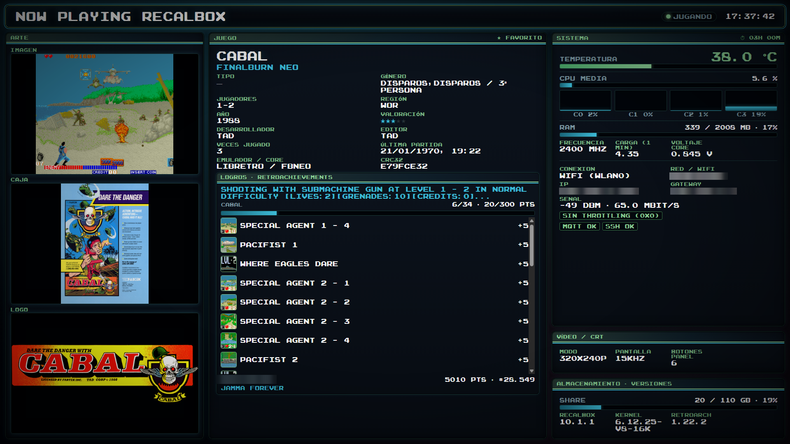
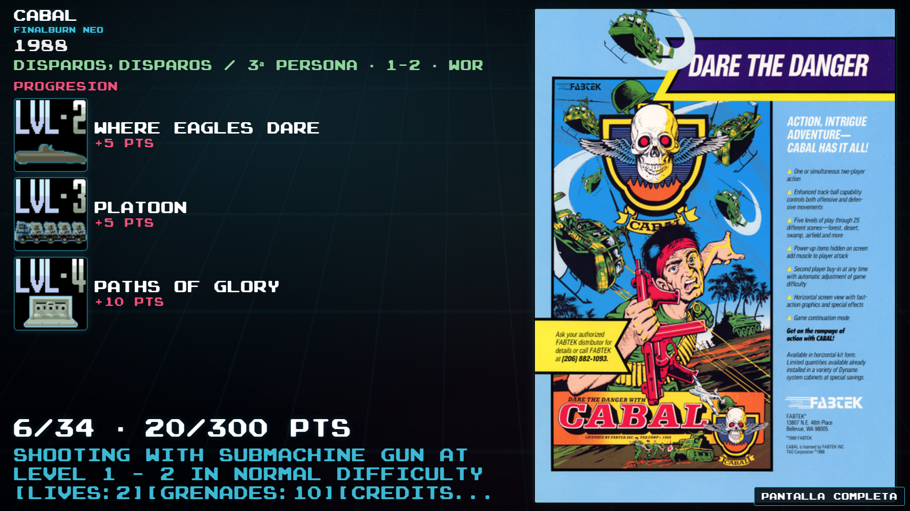
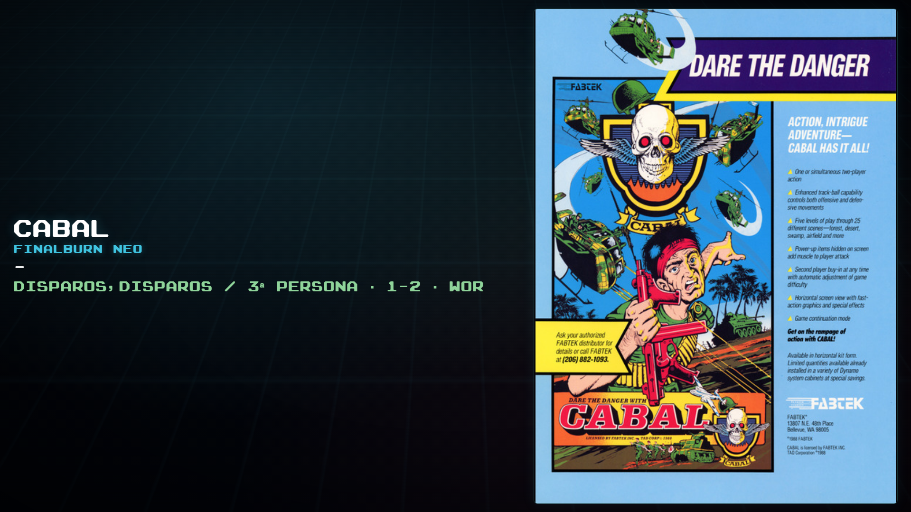

# Now Playing Recalbox

[Español](README.md) · **English**

A lightweight web server for [Recalbox](https://www.recalbox.com/) that shows on your LAN **what you are playing**, **game art**, **Pi health**, and (optionally) **[RetroAchievements](https://retroachievements.org/)** progress.

No app required: any phone, tablet, or PC on the same Wi‑Fi opens a browser and you are done. Built for a **second screen** on an arcade cabinet, living room, or desk.

---

## What is it?

Now Playing Recalbox runs **on the Recalbox itself** (Python 3, port **8787**). It reads EmulationStation state and serves two UIs:

| Path | Purpose |
| --- | --- |
| **`/`** — Now Playing | Full panel: metadata, image / box / wheel, hardware, network, achievements |
| **`/minira`** — MiniRA | Landscape tablet view: flyer + RA progress while you play |
| `/marquee` | Legacy alias → redirects to `/minira` |

Typical uses:

- Spare Android tablet in landscape as a **marquee / mini-RA** display
- Phone or desktop browser to check **temperature, network, and current game**
- CRT / arcade cab with a secondary device and zero extra installs

> v0: server core + current UI. Roadmap: [docs/PRODUCTIZATION.md](docs/PRODUCTIZATION.md).

---

## Screenshots

**Now Playing (`/`)** — in-game, art and system:



**MiniRA (`/minira`)** — playing, with pending achievements:



**MiniRA** — browsing the gamelist:



**MiniRA** — system carousel:


---

## Features

- **Live EmulationStation state** (playing, menu, gamelist, systems, screensaver)
- **Scrap art**: image, box, and wheel (fuzzy hash matching when scrap names differ)
- **System logos** from the Recalbox theme
- **Optional RetroAchievements**: progress, pending badges, rich presence, rank / motto
- **Pi hardware**: temperature, CPU, RAM, throttling, video/CRT, storage, versions
- **Network**: Wi‑Fi / ethernet, SSID, IP, gateway, signal
- **UI language** from Recalbox `system.language` (`es` / `en` / `fr`; override with `NP_LANG`)
- **QR code in MiniRA** (menu only) pointing to `http://<hostname>.local:8787/` to open Now Playing on a phone
- **Arcade R** font; auto-start via EmulationStation `[start]` userscript
- **No pip**: Python 3 from the Recalbox image only
- JSON API: `/api/now`, `/api/ra`, `/api/hw`

---

## Requirements

- Recalbox **≥ 10** (tested on **10.1.1**)
- Python 3 on the board
- Same LAN / Wi‑Fi for Recalbox and the client device
- Share is often **exFAT (noexec)** → always use `sh script.sh`, not `./script.sh`

---

## Quick start

Full guide: **[INSTALL.en.md](INSTALL.en.md)** · [Español](INSTALL.md).

1. Copy the repo contents to `/recalbox/share/now-playing/`
2. (Optional) Configure RetroAchievements — see below
3. Install userscript `userscripts/nowplaying[start].ash` into `/recalbox/share/userscripts/`
4. Start (or restart EmulationStation):

```sh
sh /recalbox/share/now-playing/start-now-playing.sh
```

5. On the client device:

```text
http://<YOUR-RECALBOX-IP>:8787/
http://<YOUR-RECALBOX-IP>:8787/minira
```

---

## RetroAchievements (optional)

```sh
cp config/ra.local.txt.example /recalbox/share/now-playing/ra.local.txt
# Edit user= and apikey= (web API key from retroachievements.org)
```

**Do not commit** `ra.local.txt`. Environment overrides: `config/env.example`.

---

## Repository layout

```text
server.py                 # HTTP :8787
np/                       # ES, RA, art, hardware, locale, paths
www/                      # Now Playing + MiniRA UI
www/fonts/                # Arcade R (ver THIRD_PARTY.md)
www/i18n/                 # es / en / fr strings
www/vendor/qrcode.js      # QR generator (MIT, Kazuhiko Arase)
config/                   # credential and env examples
tests/                    # unittest
userscripts/              # EmulationStation boot hook
start|stop-now-playing.sh
wake-marquee.sh           # optional (ADB not included)
INSTALL.md / INSTALL.en.md
docs/                     # roadmap, screenshots, specs
```

---

## Tests

```sh
python3 -m unittest discover -s tests -p 'test_*.py' -v
```

---

## Roadmap

1. ~~Publish clean core~~ (this release)
2. Multi-device UI / generic skin
3. ~~Easy discovery (hostname / QR)~~
4. (Longer term) frontends beyond Recalbox

Details: [docs/PRODUCTIZATION.md](docs/PRODUCTIZATION.md).

---

## License

[MIT](LICENSE)

## Notice

Intended for a **trusted local network**. Do **not** expose port **8787** to the Internet. This project **does not include ROMs**, BIOS files, or third-party secrets.
