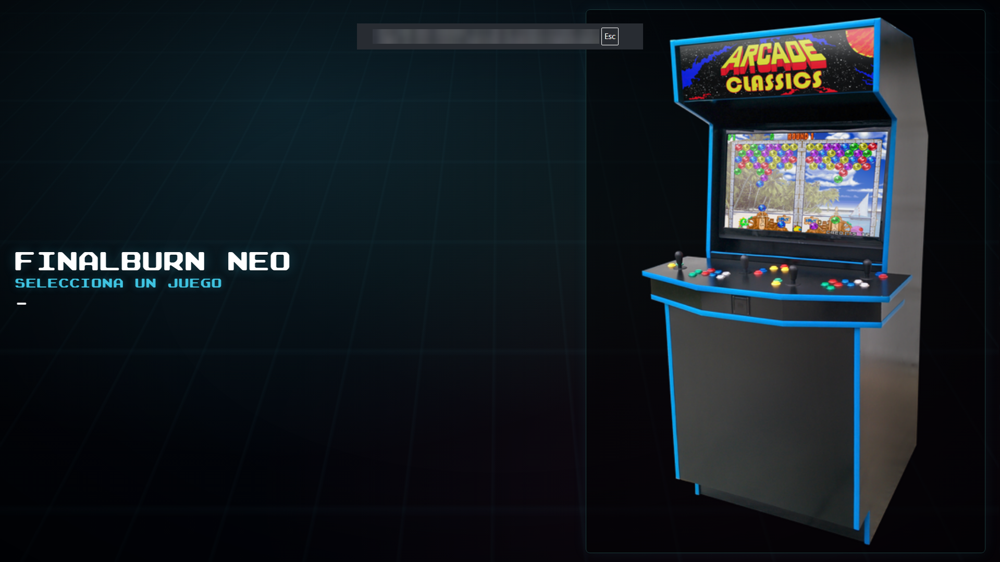

# Now Playing Recalbox

[Español](README.md) · **English**

**Now playing** and **MiniRA** on your LAN for [Recalbox](https://www.recalbox.com/): EmulationStation status, box art, system logos, and (optional) RetroAchievements.

Pages are served from the Pi itself (`:8787`). Any phone, tablet, or browser on the same Wi‑Fi can open them.

### Spare tablet or Android phone

If you have an **Android tablet or phone** sitting around, you do not need a special app: open the **browser** (Chrome, etc.), join the **same Wi‑Fi** as Recalbox, and go to:

```text
http://<YOUR-RECALBOX-IP>:8787/minira
```

You will see the current game (title, system, flyer) and, if you configure RetroAchievements, **achievement progress / remaining unlocks** while you play. Use **landscape** for MiniRA; `/` works in portrait or landscape as a fuller panel (“now playing” + hardware + network). The legacy `/marquee` path redirects to `/minira`.

> Work in progress: this v0 ships the **server core + current UI**. A more generic multi-device UI comes later. See [docs/PRODUCTIZATION.md](docs/PRODUCTIZATION.md).

---

## Screenshots




---

## Features

- **`/minira`** landscape (tablet): title, system, flyer, in-game RA achievements (badges + progress)
- **`/`**: game metadata, art (image + box + wheel), Pi hardware, network (Wi‑Fi/IP/gateway), and RA
- JSON API: `/api/now`, `/api/ra`, `/api/hw`
- System logos in the carousel (`/system-logo`) and scrap media (`/media`)
- Fuzzy wheel/logo matching when the scrap uses different hashes
- **Arcade R** font on both UIs
- UI language from Recalbox `system.language` (`es` / `en`; override `NP_LANG`)
- Correct Recalbox date parsing (Unix timestamp → year)
- Starts via EmulationStation `[start]` userscript
- No pip deps: Python 3 from the Recalbox image

## Requirements

- Recalbox **≥ 10** (tested on **10.1.1**)
- Python 3 on the board
- LAN (Recalbox share is often exFAT → run scripts with `sh …`)

## Quick start

Full install: **[INSTALL.en.md](INSTALL.en.md)** · [Español](INSTALL.md).

```sh
# On Recalbox, after copying the repo to /recalbox/share/now-playing/
sh /recalbox/share/now-playing/start-now-playing.sh
```

Then on your device:

```text
http://<RECALBOX-IP>:8787/minira
http://<RECALBOX-IP>:8787/
```

## RetroAchievements (optional)

```sh
cp config/ra.local.txt.example /recalbox/share/now-playing/ra.local.txt
# edit user= and apikey= (RA web API key)
```

**Do not commit** `ra.local.txt`. Optional env vars: see `config/env.example`.

## Layout

```text
server.py              # HTTP :8787
np/                    # ES state, RA, DTOs, art, hardware, paths
www/                   # index (/) + minira + marquee redirect
www/fonts/             # Arcade R
config/                # ra.local.txt / env examples
tests/                 # unittest
userscripts/           # nowplaying[start].ash
start|stop-now-playing.sh
wake-marquee.sh        # optional (ADB not included; opens MiniRA)
INSTALL.md
docs/PRODUCTIZATION.md # product roadmap
docs/screenshots/      # README screenshots
```

## Tests

```sh
python3 -m unittest discover -s tests -p 'test_*.py' -v
```

## Roadmap (short)

1. ~~Publish clean core~~ (this release)
2. Multi-device UI / generic skin
3. Easy discovery (hostname / QR)
4. (Later) frontends beyond Recalbox

Details: [docs/PRODUCTIZATION.md](docs/PRODUCTIZATION.md).

## License

[MIT](LICENSE)

## Notice

Intended for a **trusted local network**. Do not expose port 8787 to the Internet. Does not include ROMs or third-party secrets.
