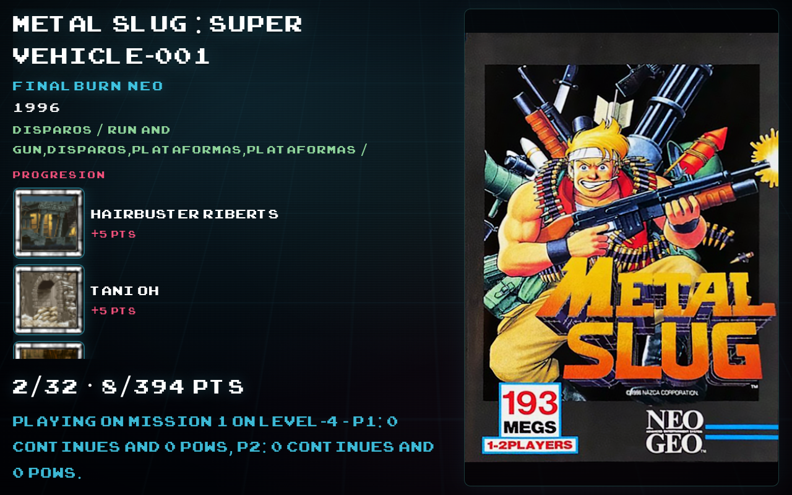
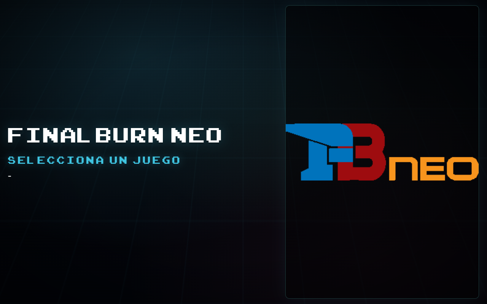
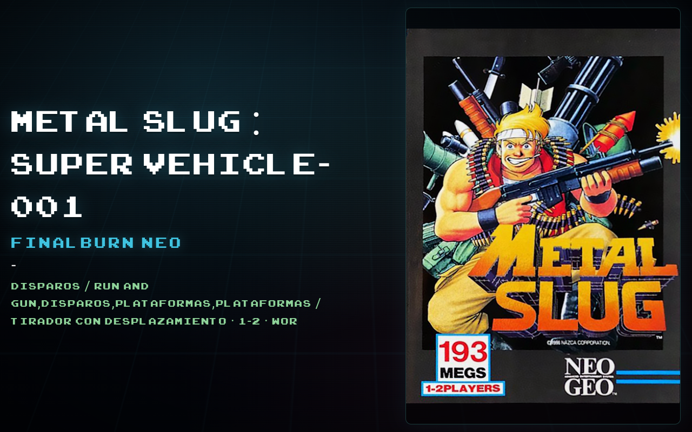
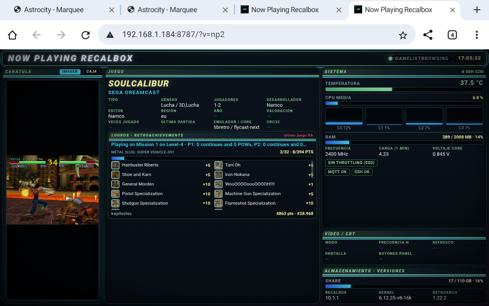

# Now Playing Recalbox

**Now playing** y **marquee** en la LAN para [Recalbox](https://www.recalbox.com/): estado de EmulationStation, carátulas, logos de sistema y (opcional) RetroAchievements.

Sirve páginas web desde la propia Pi (`:8787`). Cualquier móvil, tablet o navegador en la misma WiFi puede abrirlas.

### Tablet o Android que casi no usas

Si tienes una **tablet o un móvil Android** aparcado, no hace falta instalar nada especial: abre el **navegador** (Chrome, etc.), conéctate a la **misma WiFi** que la Recalbox y entra en:

```text
http://<IP-DE-TU-RECALBOX>:8787/marquee
```

Ahí verás el juego actual (título, sistema, carátula) y, si configuras RetroAchievements, el **progreso / pendientes de logros** mientras juegas en la cabina o en el salón. Gira el dispositivo a **horizontal** para la vista marquee; la ruta `/` vale también en vertical para un resumen más “móvil”.

> Trabajo en curso: esta v0 publica el **núcleo servidor + UI actual**. La UI genérica / multi-dispositivo se pulirá en siguientes iteraciones. Ver [docs/PRODUCTIZATION.md](docs/PRODUCTIZATION.md).

---

## Capturas









---

## Características

- Vista **`/marquee`** landscape: título, sistema, flyer, logros RA (en juego)
- Vista **`/`** tipo “ahora jugando” + hardware Pi
- API JSON: `/api/now`, `/api/ra`, `/api/hw`
- Logos de sistema en el carrusel (`/system-logo`)
- Parseo correcto de fechas Recalbox (timestamp Unix → año)
- Arranque con userscript EmulationStation `[start]`
- Sin dependencias pip: Python 3 de la imagen Recalbox

## Requisitos

- Recalbox **≥ 10** (probado en **10.1.1**)
- Python 3 en la placa
- Red LAN (el share Recalbox suele ser exFAT → scripts con `sh …`)

## Inicio rápido

Instalación completa: **[INSTALL.md](INSTALL.md)**.

```sh
# En la Recalbox, tras copiar el repo a /recalbox/share/now-playing/
sh /recalbox/share/now-playing/start-now-playing.sh
```

Luego en el dispositivo:

```text
http://<IP-RECALBOX>:8787/marquee
http://<IP-RECALBOX>:8787/
```

## RetroAchievements (opcional)

Copia `config/ra.local.txt.example` → `ra.local.txt` en la carpeta del servidor y rellena usuario + API key web. **No subas ese fichero a git.**

## Estructura

```text
server.py              # HTTP :8787
np/                    # estado ES, RA, DTO, años, paths
www/                   # marquee + index
tests/                 # unittest
userscripts/           # nowplaying[start].ash
start|stop-now-playing.sh
wake-marquee.sh        # opcional (ADB no incluido)
docs/PRODUCTIZATION.md # roadmap producto / compartir
docs/screenshots/      # capturas para el README
```

## Tests

```sh
python3 -m unittest discover -s tests -p 'test_*.py' -v
```

## Roadmap (resumen)

1. ~~Publicar núcleo limpio~~ (esta release)
2. UI multi-dispositivo / skin genérica
3. Descubrimiento fácil (hostname / QR)
4. (Largo) otros frontends aparte de Recalbox

Detalle: [docs/PRODUCTIZATION.md](docs/PRODUCTIZATION.md).

## Licencia

[MIT](LICENSE)

## Aviso

Pensado para **red local de confianza**. No exponer el puerto 8787 a Internet. No incluye ROMs ni claves de terceros.
